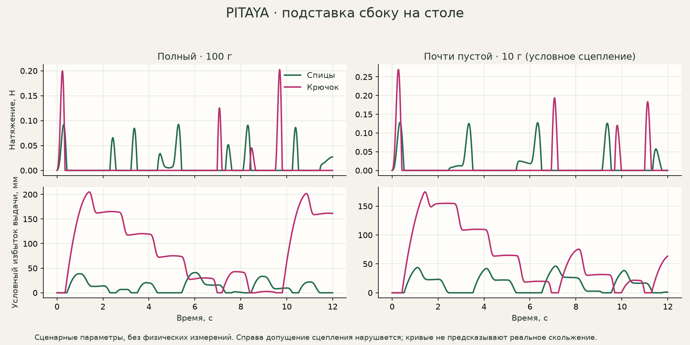

# Yarn Stand Simulator

Небольшая воспроизводимая математическая модель вращающейся подставки для пряжи.
Сравнивает полный и почти пустой **круглый клубок с размоткой снаружи**, спицы и
крючок, расположение на столе и на полу, массу, ножки и сопротивление вращению.

Числа в примерах — **инженерные допущения до пробной печати и измерений**.
Это не рейтинг удобства кисти и не модель всех отдельных волокон. Результат
помогает выбрать, что изменить и проверить руками.



## Запуск

Python 3.10 или новее. Основной расчёт и интерфейс используют только стандартную
библиотеку: установка пакетов и GPU не нужны. Выполняйте команды из корня проекта.

```sh
python -m yarnstand serve
```

Откройте <http://127.0.0.1:8765>. Можно менять клубок, положение руки, ритм,
массу, радиус ножек и трение. В разделе «Все параметры» доступна полная
конфигурация, включая произвольный многоугольник опоры. Данные не уходят во
внешние сервисы. Остановка сервера — Ctrl+C.

```sh
# Создать редактируемые параметры
python -m yarnstand preset --ball nearly_empty --motion crochet --setup high_table --out examples/my_stand.json
# Изменить нужные значения в JSON и посчитать
python -m yarnstand run examples/my_stand.json --out results/custom.json
# Воспроизвести таблицы сравнения и анализ чувствительности
python -m yarnstand suite
python -m yarnstand sensitivity
# Проверки физических предельных случаев и сходимости
python -m unittest discover -s tests -v
# Проверки состояния интерфейса (только для разработки, Node 18+)
node --test tests/test_ui.js
```

Установка как обычного пакета необязательна: `python -m pip install .` добавит
команду `yarnstand`. Для графиков отчёта отдельно нужен matplotlib:
`python -m pip install matplotlib`, затем `python tools/make_report.py`.

## Что считается

- Пусковое, среднее, 95-й процентиль и пиковое натяжение нити.
- Разгон, остановка и условный избыток выдачи нити при выбеге.
- Начало сдвига, опрокидывания или отрыва подставки.
- Хватает ли сцепления, чтобы клубок и площадка вращались вместе.
- Грубая проверка пути натянутой нити около края и декора.
- Чувствительность к трению подшипников, ножек и сопротивлению размотке.

Ритмы «спицы» и «крючок» — **два редактируемых примера подачи**, не результаты
исследования вязальщиц. Можно заменить длину протяжки, период, долю активного
движения и амплитуду перемещения руки. Высота руки задаётся **относительно
поверхности под ножками**, а не от верхней площадки. Отрицательная высота допустима.

## Примеры подставок

`peach_v13` — персик: площадка на 70.7 мм над столом, шесть ножек Ø7.9 мм
на радиусе 54 мм. Масса около 300 г и инерция 0.0000545 кг·м² получены из
CAD, диагностического слайсинга и допущений о крепеже, **не измерены**.
В интерфейсе есть выбор подставки; `/?stand=peach_v13` открывает персик.
Листья персика не заменены эллипсоидами в быстрой схеме: их нужно проверять
по реальным STL отдельными командами [mesh-check и mesh-sweep](docs/mesh.md).

`pitaya_v08` использует геометрию проекта PITAYA v08: площадка Ø104 мм, шесть
ножек Ø10 мм на окружности радиусом 52 мм, верх площадки около 45 мм над столом.
Масса 230 г и инерция ротора 0.000065 кг·м² — оценки, **не взвешивание**.
Площадь опоры определяется ножками, а не внешним диаметром розового корпуса.

`pitaya_v09` — вариант с широкими стилизованными листьями (около 34 мм).
Параметры механизма и оценки массы сохранены; для листьев заданы более широкие
приближённые эллипсоиды. Это не точная поверхность CAD. Пример:

```sh
python -m yarnstand preset --stand pitaya_v09 --out examples/pitaya_v09.json
python -m yarnstand run examples/pitaya_v09.json --out results/pitaya_v09.json
```

Точная проверка выбранных траекторий по STL v09 сохранена отдельно в
[`results/pitaya_v09_mesh_paths.json`](results/pitaya_v09_mesh_paths.json).
Она не моделирует деформацию клубка или свободные петли. Исходные таблицы
`scenarios.csv` и `sensitivity.csv` по-прежнему относятся к указанной в них v08.
При наличии распакованного CAD-комплекта v09 её можно воспроизвести отдельно:
`python -m pip install vtk`, затем
`python tools/check_pitaya_mesh_paths.py /path/to/PITAYA_v09`.
Этот дополнительный скрипт ожидает систему координат сборки PITAYA;
основной симулятор по-прежнему работает без VTK и без CAD-файлов.

`wide_feet` — гипотетическая другая подставка с ножками на радиусе 62 мм;
это не готовая модификация корпуса PITAYA. `light_small` — пример лёгкой
компактной конструкции. `high_drag` показывает более тугой вращающийся узел.

Полный клубок: 100 г, полуоси 45×45×44 мм. Почти пустой: 10 г,
21×21×23 мм. Неподвижный размер в каждом 12-секундном прогоне — снимок состояния,
а не моделирование расхода всего клубка за вечер. Большой клубок 200 г есть
в интерфейсе; его выход за край площадки явно отмечается.

## Как читать результат

Сначала смотрите `first_events_s`. Если там есть проскальзывание или потеря
опоры, последующая кривая — **условное продолжение при принудительном сцеплении**.
Она не предсказывает движение уже съехавшего клубка. Не сравнивайте такие пики
как точные силы реального вязания.

`valid_coupled_interval_end_s` и `peak_tension_before_first_event_N` выделяют
участок до первого нарушения этих условий. В каждой точке графика JSON есть
`coupled_assumptions_valid`; последующие пики нельзя выдавать за расчёт уже
скользящего клубка.

`critical_snag_N` — квазистатический порог внешней силы, при котором первым
нарушается одно условие опоры. Это не расчёт удара. `max_slack_m` — избыток
подачи при идеальном разматывании во время выбега; реальные петли могут
провисать, оборачиваться вокруг клубка и зацепляться. При большой слабине
программа выдаёт отдельное предупреждение.

**Модель не покрывает** размотку из центра, падение подставки, мягкий диван,
деформацию и схлопывание клубка, подробную намотку нити, микрозацепы FDM,
изменение позы человека или натяжение, создаваемое пальцами после подставки.
Высокий угол тяги отдельно отмечается: нить может сходить через верх клубка,
а не заставлять его вращаться в принятом режиме.

- [Уравнения, единицы и границы применимости](docs/model.md)
- [Проверка персика v13](docs/peach-v13.md)
- [Короткая калибровка после печати](docs/calibration.md)
- [Результаты для PITAYA и сравнительных вариантов](docs/results.md)
- [Повторная проверка PITAYA v10 по STL и STEP](docs/pitaya-v10-recheck.md)
- [Сырые сценарии](results/scenarios.csv)
- [Чувствительность](results/sensitivity.csv)

Все исходные параметры сохраняются вместе с результатом. Для JSON экспорт
неопределённых / бесконечных значений использует `null`, причины сохраняются
в событиях и статусах.
