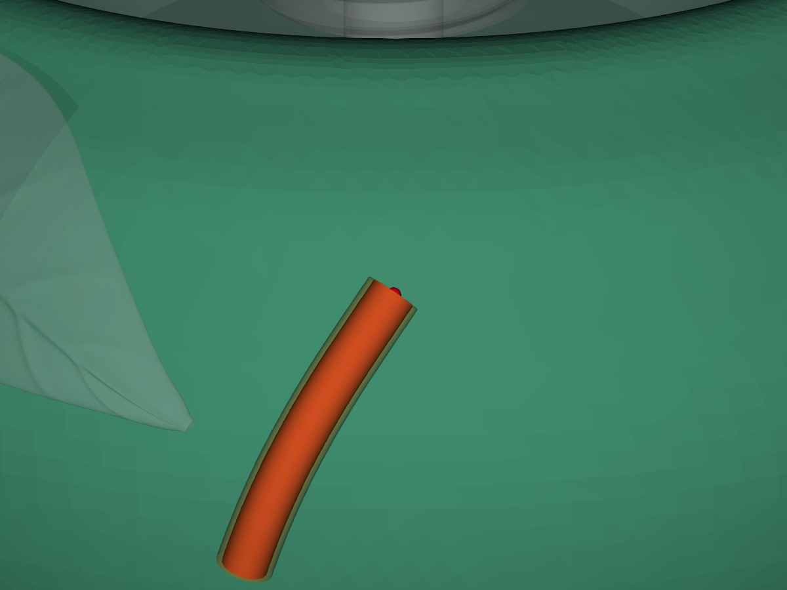
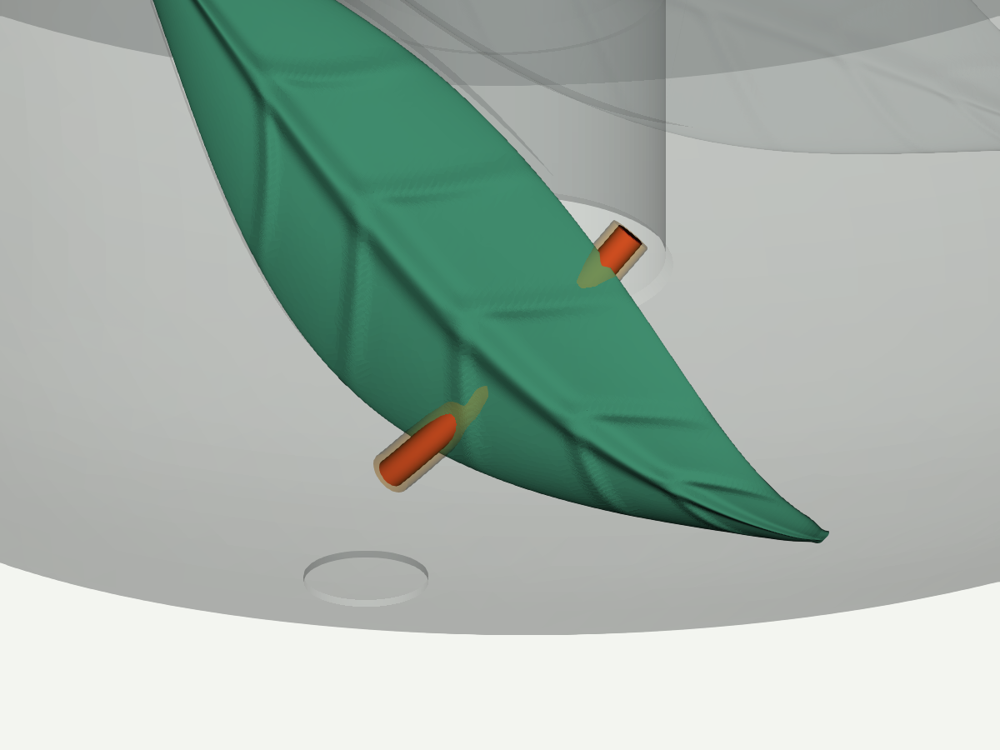

# Персик v13: зоны для проверки перед печатью

Проверены восемь сохранённых движений нити под листьями и четыре стресс-сценария
у края вращающейся площадки. Диаметры нити — 2 и 4 мм. Добавочный запас по радиусу
0.5 мм: печать 0.2, ворс 0.2, сетка 0.05, резерв 0.05 мм. Это проектные допущения.

**Итог: 7 сценариев свободны с запасом, 4 имеют номинальный контакт,
1 не проходит по заданному запасу.** Четыре проверки полного оборота площадки
проходят; это относится к сохранённому положению отрезка нити у края.
Прохождение остальных положений из этого не следует.

## Тесный проход после малого листа

В `sweep_second_4mm_tip` номинальный зазор до корпуса уменьшается примерно
до **0.189 мм**. При запасе 0.5 мм его недостаточно: разница примерно **0.311 мм**.
Уточнение с пространственным шагом и шагом движения 0.025 мм даёт нижнюю
границу зазора с запасом **−0.336 мм**. Возле самого малого листа эта граница
после уточнения положительна, около **+0.019 мм**.

Место на корпусе `01_body_peach.stl`, координаты исходного CAD-STL, мм:
**X=68.553, Y=24.973, Z=49.451**. Это зона, где нить после движения у кончика
приближается к корпусу. Чтобы соблюсти выбранный запас, нужно изменить проход
или обеспечить иной допустимый путь. Число дефицита не является готовой
командой срезать столько материала: после изменения проверяется весь путь.



Красная трубка — номинальная нить, полупрозрачная оболочка — проверочный запас.
Зелёным выделена проверяемая деталь; светлые детали показывают контекст сборки.
Это заданная проверочная поза, не рассчитанная деформация при контакте.

## Маршруты к основаниям листьев

Все четыре исходных маршрута к основаниям встречают препятствие. Координаты
первого обнаруженного контакта с листом приведены в его исходной системе, мм:

| Сценарий | Деталь | X | Y | Z |
|---|---|---:|---:|---:|
| Большой лист, нить 2 мм | `04_leaf_green.stl` | 77.767 | −24.698 | 23.149 |
| Большой лист, нить 4 мм | `04_leaf_green.stl` | 79.647 | −21.934 | 18.849 |
| Малый лист, нить 2 мм | `08_leaf_second_green.stl` | 75.938 | −0.555 | 49.723 |
| Малый лист, нить 4 мм | `08_leaf_second_green.stl` | 79.077 | 5.871 | 46.579 |

Начальная поза не пересекает лист. В ходе заданного движения нить попадает
в его объём. Это повод проверить обратную сторону, переходы и возможность
выхода наружу. Простое скругление может оставить нависающий выступ;
его эффективность проверяется повторением сохранённого движения.



Другие сохранённые пути, проходящие у кончиков большого листа, свободны с
запасом для обоих диаметров. У малого листа путь 2-мм нити свободен с запасом.
Эти пути имеют собственные начальные положения: их нельзя считать доказанным
способом освобождения нити из любого положения под основанием.

## Файлы для правки и повторения

- [Сценарии](../results/peach_v13_snags/cases.json) и [манифест сборки](../results/peach_v13_snags/scene.json).
- [Полный отчёт](../results/peach_v13_snags/report.html), [JSON](../results/peach_v13_snags/audit.json).
- [Уточнение тесного прохода](../results/peach_v13_snags/refined_tip/report.html).
- [STL-маркеры зон и соответствие деталям](../results/peach_v13_snags/review_markers.json).

```sh
python -m yarnstand snag-audit results/peach_v13_snags/scene.json results/peach_v13_snags/cases.json --out results/peach_new_revision
python -m yarnstand snag-compare results/peach_v13_snags/audit.json results/peach_new_revision/audit.json --out results/peach_comparison.json
```

Тест показывает геометрическое препятствие и недостаточный запас. Он не выдаёт
силу удержания, вероятность зацепа или гарантию отсутствия микрозацепов печати.
Метод, покрытие и ограничения: [snags.md](snags.md).
