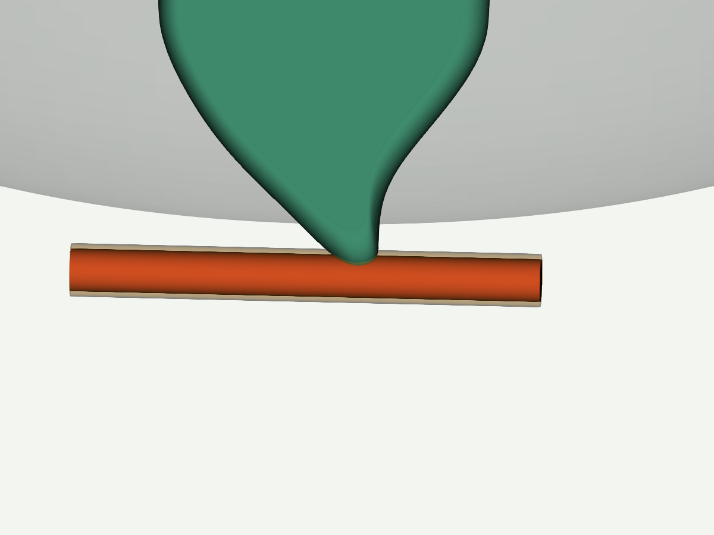

# PITAYA v10: зоны зацепа перед печатью

Проверены **40 сценариев** с добавочным радиальным запасом 0.5 мм:
36 движений под шестью листьями (три маршрута, диаметры 2/4 мм) и четыре
проверки полного оборота площадки с нитью у её края.

Итог: **8 свободны с запасом, 30 имеют контакт в ходе движения,
2 пересекают корпус уже в начальной позе**. Это специально выбранные стресс-сценарии,
а не доли или вероятности зацепов при обычном вязании.

## Что менять или проверять в CAD

| Движение | Нить 2 мм | Нить 4 мм |
|---|---|---|
| Подъём петли прямо вверх под листом | Контакт, все 6 листьев | Контакт, все 6 листьев |
| Подъём по диагонали наружу | Контакт, все 6 листьев | Контакт, все 6 листьев |
| Сначала наружу внизу, затем вверх | Свободно с запасом, все 6 листьев | Контакт с нижними кончиками, все 6 листьев |
| Нить у края площадки, полный оборот в обе стороны | Свободно с запасом | Начальный контакт с корпусом |

У 4-мм нити найдено препятствие даже на маршруте, который свободен для 2-мм.
У листа 1 проблемная поверхность находится примерно в точке
**X=69.170, Y=45.457, Z=2.871 мм** исходного `cad/leaf_1.stl`.
В координатах сборки над опорой это Z≈3.871 мм. Сценарий держит центр 4-мм нити
на высоте 3 мм при движении наружу; нижняя номинальная поверхность нити остаётся
на 1 мм над опорой. Верхняя часть нити встречает низ кончика.



Красная трубка — нить, полупрозрачная оболочка — запас; зелёный — проверяемый лист.
На рисунке заданная поза показывает геометрическое препятствие, а не рассчитанное
продавливание нити сквозь деталь.

Для правки следует рассмотреть нижний кончик и обеспечить непрерывный выход
петли наружу с достаточным зазором. Проверка одного скругления или только тонкой
нити этого не подтверждает. Повторить нужно все сохранённые маршруты и диаметры;
изменение высоты листа также требует проверки его посадки и прочности.

В сценариях у вращающегося края 4-мм нить уже в начальной позе касается корпуса.
Это не доказательство закусывания вращением и не успешный тест освобождения.
Нужно отдельно определить допустимый исходный путь нити около этого края.

## Файлы

- [Отчёт HTML](../results/pitaya_v10_snags/report.html) и [полные результаты JSON](../results/pitaya_v10_snags/audit.json).
- [40 исходных сценариев](../results/pitaya_v10_snags/cases.json) и [сборка](../results/pitaya_v10_snags/scene.json).
- [Маркеры зон для импорта поверх соответствующего STL](../results/pitaya_v10_snags/review_markers.json).

```sh
python tools/run_snag_audit_parallel.py results/pitaya_v10_snags/scene.json results/pitaya_v10_snags/cases.json --out results/pitaya_new_revision --workers 3
python -m yarnstand snag-compare results/pitaya_v10_snags/audit.json results/pitaya_new_revision/audit.json --out results/pitaya_comparison.json
```

Проверка не моделирует автоматическое огибание, сжатие и трение пряжи,
образование петель или микрозацепы печати. Она даёт геометрические зоны риска
и повторяемое сравнение правок. [Метод и параметры](snags.md).
