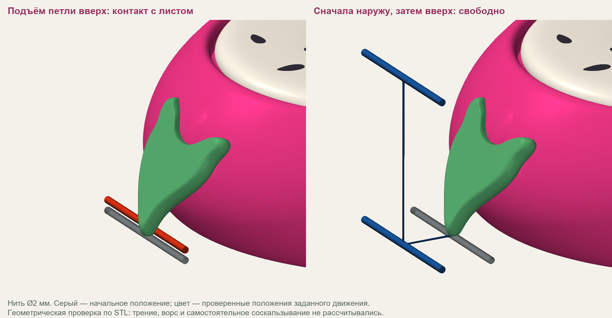

# PITAYA v10: повторная проверка, 18 октября 2026

> Архивный расчёт до аудита модели. Числа траекторий и динамики ниже заменены
> [пересчётом модели 0.2.0](audit-fixes.md). В частности, 696 свободных путей
> включали недопустимые линии через клубок. Раздел о CAD-посадках остаётся
> отдельной проверкой неизменённой геометрии.

Взята текущая CAD-геометрия v10 с широкими листьями, розовым микроязычком
и сдвинутым первым штифтом. Обновление симулятора подтянуто с
`f5322a7932dea19f92ca371f747bcb993a7e9e73`; локальных изменений перед обновлением
не было. В ходе проверки исправлен дополнительный численный допуск VTK.
Хеши реально рассчитанных исходников, STL и преобразования координат сохранены
в [metadata.json](../results/pitaya_v10_recheck/metadata.json).

**Вывод: вращающийся узел не имеет найденных пересечений, но v10 ещё нельзя
считать проверенной печатной посадкой.** Между листом и корпусом обнаружен
минимальный CAD-зазор всего 0,0098 мм. Кроме того, свободная петля под листом
не может пройти по некоторым заданным траекториям подъёма без контакта.

| Проверка | Результат |
|---|---|
| Натянутая нить Ø2 мм, 0,04 Н | 696 свободных путей, 24 с контактом из 720 |
| Диаметр 1/2/4 мм и натяжение 0,01/0,04/0,10 Н | 54 дополнительных случая; найден контакт толстой слабонатянутой нити |
| Заданные движения руки | 22 свободных протяжки, 2 с начальным контактом из 24 |
| Три маршрута петли под листом | Два с контактом, один геометрически свободен |
| Динамика вращения и опоры | 60 сценариев; сцепление почти пустого клубка нарушается в 30 из 30 |
| CAD-посадка | Пересечений не найдено; минимальный зазор листа слишком мал для вывода о печатной совместимости |

Это количества выбранных сценариев, **не вероятности** зацепления или успеха.

## Нить и листья

Основная сетка: полный и почти пустой клубок, пять положений подставки,
три высоты схода нити и 24 азимута. Диаметр нити 2 мм, натяжение 0,04 Н.
В сцену включены корпус, площадка, семечки, палочка, шесть листьев и ножки.
Начало Z перенесено на поверхность под ножками (+1 мм к CAD).

Все 24 контакта основной сетки относятся к почти пустому клубку, нижнему
сходу нити и высокой подставке: руки на 5 см ниже поверхности под ножками,
на горизонтальном расстоянии 35 см. Нить встречает корпус и площадку;
в шести направлениях — также листья. Все остальные 696 путей имеют
положительную консервативную границу зазора, минимум около 1,11 мм.

При меньшем натяжении 0,01 Н и полном клубке в той же низкой траектории
нить Ø4 мм уже касается корпуса. Для Ø2 мм уточнение шага даёт всего
около 0,046 мм минимального вычисленного зазора (нижняя граница 0,021 мм).
Этот формально свободный путь практически близок к касанию: погрешность
сетки, печати и ворс в границу не включены.



Для свободной петли проверен поперечный участок нити под первым листом:
центр на радиусе 80 мм, высота 2 мм над столом, длина участка 44 мм.
При прямом подъёме контакт появляется примерно на высоте 5 мм. При одновременном
подъёме и смещении наружу выбранный диагональный маршрут тоже касается листа.
Если сначала отвести нить на радиус 95 мм, а затем поднять, заданный путь
свободен; нижняя граница зазора около 0,38 мм.

Это показывает геометрическое препятствие под кончиком. Расчёт **не доказывает**,
что настоящая мягкая петля застрянет либо сама соскользнёт: трение, ворс,
деформация, самостоятельный обход препятствия и усилие освобождения не считаются.
Микроязычок у верхнего стыка не устраняет этот нижний выступ.

## Посадка и вращающийся узел

Проверены сохранённые STEP корпуса и листа v10, шесть установленных листьев,
шесть положений вставки и неизменённый механизм v09. Хеши площадки, палочки,
семечек, втулок, подшипников, крепежа и ножек совпадают с v09.

Пересечений корпуса с площадкой, палочкой, крепежом и цилиндрическим объёмом,
занимаемым вращающейся площадкой, не найдено. Минимальное расстояние
корпус–площадка — 0,8 мм. Кончик листа находится примерно в 3,87 мм над столом.

Минимальное расстояние лист–корпус — **0,0098 мм** у внутренней стороны верхнего
выступа листа. Для v09 аналогичная проверка даёт 0,0183 мм: проблема не появилась
с нуля в v10. Масштабирование контура кармана не обеспечивает одинаковый зазор
по всему сложному контуру. Перед печатью нужен карман с контролируемым зазором
и небольшая проба посадки. Отсутствие пересечений не подтверждает возможность
сборки реальных деталей с погрешностями печати.

## Динамика

Масса подставки 230 г, инерция ротора 0,000065 кг·м² и коэффициенты трения
сохранены как прежние **оценки**, а не новые измерения v10. Масса клубков 100 и
10 г. Дополнительное сцепление с палочкой принято равным нулю.

Для полного клубка во всех 30 сценариях не обнаружены срыв сцепления,
сдвиг или начало опрокидывания. Максимальное использование расчётного предела
сдвига около 20%, опрокидывания — 23%. Для положения сбоку на столе и схода
из середины пиковое натяжение около 0,107 Н в примере спиц и 0,231 Н в примере крючка.

Для почти пустого клубка все 30 сценариев нарушают условие совместного вращения
клубка и площадки через 0,08–0,21 с. После этого кривая — условное продолжение,
а не прогноз реального скольжения. Семь поздних событий отрыва также лежат после
потери сцепления и не являются самостоятельными достоверными прогнозами.
Первым делом здесь нужно измерять сопротивление вращению и сцепление клубка
с площадкой/палочкой, а не усиливать основание по этим условным пикам.

В резком примере крючка полный клубок даёт до 211 мм условного избытка выдачи
при выбеге. Это показатель чувствительности к ритму и торможению, а не
предсказанная форма или фактическая длина свисающей петли.

## Исправление симулятора и воспроизведение

У `vtkOBBTree` обнаружен стандартный допуск `0.01`: при работе в метрах это
сантиметр. Он скрывал некоторые пересечения коротких отрезков с кривыми
поверхностями. В PITAYA проверка знакового расстояния всё равно находила
24 основных контакта, но отдельный список пересечений был ошибочно пуст.
Допуск теперь явно `1e-9` м. Добавлен регрессионный тест на хорде сферы;
повторный прогон восстановил пересечения. Прошли **38 Python-тестов и 9 JS-тестов**.

```sh
python -m pip install ".[mesh]"
python tools/recheck_pitaya.py /path/to/PITAYA_v10 --out results/pitaya_v10_recheck
# Отдельная проверка STEP, дополнительно требуется CadQuery:
python tools/check_pitaya_cad.py /path/to/PITAYA_v10 /path/to/PITAYA_v09 --out results/pitaya_v10_recheck/cad_fit.json
# Иллюстрация сохранённых протяжек; дополнительно нужен Pillow:
python tools/render_pitaya_sweeps.py /path/to/PITAYA_v10 --results results/pitaya_v10_recheck
```

CAD-пакеты передаются отдельно. В [каталоге результатов](../results/pitaya_v10_recheck)
сохранены все конфигурации, таблицы, заданные позы, результаты по кадрам,
хеши геометрии и проверка STEP. Последний полный комплект нарезки остаётся v09;
v10 пока имеет статус CAD-прототипа.
