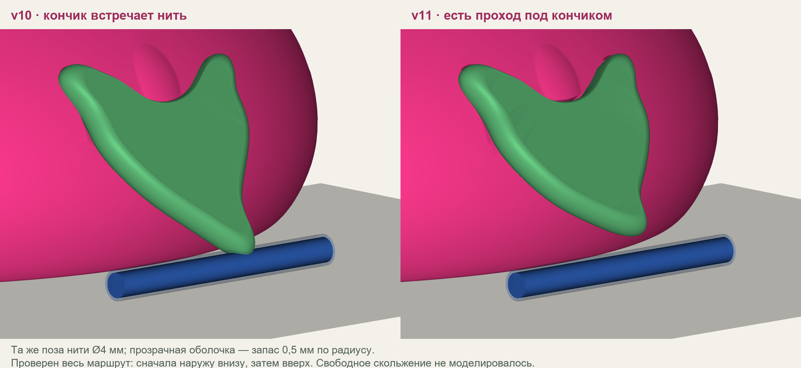
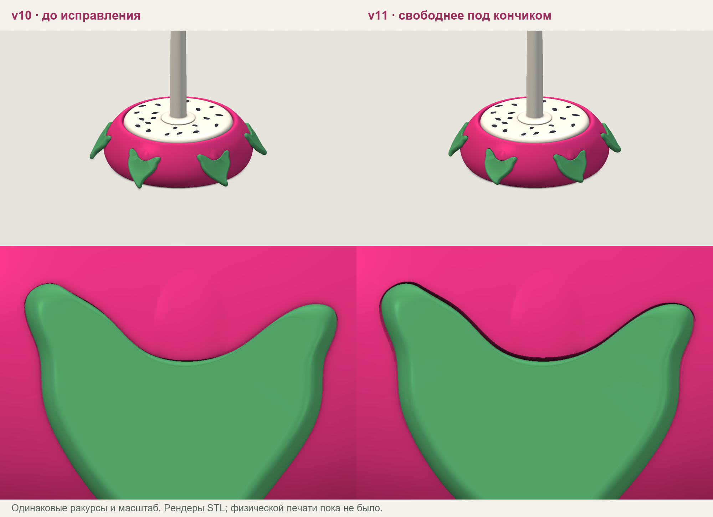

# PITAYA v11: исправления CAD и повторный расчёт 0.3.0

В v11 исправлены тесная посадка широких листьев и низкий кончик, мешавший
вывести наружу нить Ø4 мм. V10 сохранена отдельно. Микро-язычок у верхнего стыка,
широкие асимметричные листья, 21 семечко и вращающийся механизм сохранены.
Это проверенный в CAD и слайсере **непечатавшийся прототип**: перед большим
корпусом нужна физическая проба посадки листа.



## Изменения геометрии

| Параметр | V10 | V11 |
|---|---:|---:|
| Минимальный просвет листа над столом | 3,870 мм | 6,974 мм |
| Минимальное расстояние поверхностей лист–корпус | 0,00978 мм | 0,21034 мм |
| Ширина листа в его плоскости | около 34,3 мм | 34,34 мм |
| Свободные исходные стресс-сценарии | 8 из 40 | 14 из 40 |
| Контакт во время движения | 30 | 24 |
| Контакт уже в исходной позе | 2 | 2 |

Дистальная часть листа плавно укорочена в локальной плоскости максимум на
3,8 мм; изменение начинается после X=18 мм. Это поднимает низ примерно на
3,1 мм без изменения положения двух штифтов. Толщина и скруглённая кромка
сохранены; корни не сделаны тоньше для получения свободного прохода.

Углубление корпуса получено смещением контура на 0,40 мм вместо масштабирования
вокруг центра. Зазор сзади — 0,35 мм, радиальный зазор штифтов — 0,25 мм.
Номинальное смещение контура не равно минимальному пространственному зазору
округлых деталей: последний отдельно измерен и составляет 0,21034 мм.

При сохранении STEP выявлена особенность OpenCascade 7.9: поверхности,
выдавленные непосредственно из offset-кривой, терялись при обратном импорте.
В итоговом исходнике только контур углубления преобразован в B-сплайн с
заданным допуском 0,00001 мм **до** создания тела. Итоговые STL и STEP созданы
из этой же геометрии, после чего расчёты и нарезка повторены.



## Одинаковые сценарии до/после

Обе версии проверены одним кодом симулятора **0.3.0, a698bae1f233cdacc0f07e7d9bcadbe07bd1b44e**.
Хеши выполненных файлов и сеток, версии Python/VTK/trimesh сохранены в отчётах.
Финальный `snag-compare` подтверждает `same_audit_code=true` и
`same_runtime=true`: **6 улучшений, 0 ухудшений**, 26 оставшихся отмеченных случаев.

Исходные [40 сценариев](../results/pitaya_v11_validation/cases.json) не изменены.
Оба шага — пространственный и движения — 0,25 мм. Дополнительный запас
**по радиусу** 0,5 мм: печать 0,2; ворс 0,2; сетка 0,05; резерв 0,05 мм.
Это проектные допущения, не измеренная точность печати или ворс конкретной пряжи.
`unresolved_clearance` нет ни по сценариям, ни по деталям; дополнительного
уточнения шагов для разрешения неопределённости не потребовалось.

| Движение под каждым из 6 листьев | V10, Ø2/4 мм | V11, Ø2/4 мм |
|---|---|---|
| Прямой подъём | контакт / контакт | контакт / контакт |
| Диагонально наружу и вверх | контакт / контакт | контакт / контакт |
| Сначала наружу внизу, затем вверх | свободно / контакт | свободно / свободно |

У листа 1 нижняя граница зазора на последнем маршруте после вычета запаса
и поправок на оба шага составляет **3,225 мм для Ø2 мм** и **1,226 мм для Ø4 мм**.
Все шесть листьев проверены отдельно. Сохранённые движения — стресс-сценарии,
их доли не являются вероятностью появления зацепа при вязании.

Два исходных случая Ø4 мм у вращающегося края пересекают неподвижный корпус
ещё до вращения. Они остались в исходном наборе с соответствующим статусом;
это не доказанное закусывание вращением. В [отдельном дополнительном наборе](../results/pitaya_v11_validation/additional_rim_cases.json)
центр нити поднят с 44,11 до 46,11 мм при тех же XY, диаметре, запасе и полном
обороте в обе стороны. Оба дополнительных случая свободны. Они не заменяют
исходные два неудачных положения и не входят в число 6 улучшений.

- [До: полный snag-audit](../results/pitaya_v11_validation/before/snags/audit.json).
- [После: полный snag-audit](../results/pitaya_v11_validation/after/snags/audit.json) и [HTML](../results/pitaya_v11_validation/after/snags/report.html).
- [Сравнение](../results/pitaya_v11_validation/comparison.json).
- [Дополнительная проверка вращающегося края](../results/pitaya_v11_validation/after/additional_rim/audit.json).

## Номинальные пути и механика

Обе геометрии повторно проверены после исправления знака расстояния в 0.3.0.
Для каждой: 720 статических путей, 54 случая диаметра/натяжения, 60 динамических
сценариев и 27 заданных движений. Полный и почти пустой круглые клубки, спицы
и крючок, пять положений подставки, разные высоты выхода и азимуты сохранены.
Масса подставки 230 г, инерция вращающегося узла 0,000065 кг·м², трение и ритмы
подачи остаются одинаковыми сценарными оценками. Правка листьев не выдаётся
за измеренное изменение этих физических параметров.

Адаптивный выбор ближайших к контакту азимутов может меняться даже при малой
правке из-за симметричных направлений с почти одинаковыми зазорами. Поэтому
54 сочетания диаметра/натяжения для v11 явно воспроизведены из сохранённого
набора v10; их параметры совпадают, источник и его хеш записаны в метаданных.

В обеих версиях из 720 номинальных путей **456 свободны, 24 касаются деталей,
240 входят в клубок и отклонены как недопустимые**. Все 24 контакта относятся
к почти пустому клубку, низкому выходу и рукам ниже высокой подставки.
Для такого расположения нужен другой путь схода/положение подставки;
срезать корпус ради заданного пути через него нельзя считать исправлением.

Из 24 движений руки 14 свободны, 2 имеют начальный контакт, 8 отклонены из-за
входа нити в клубок. Ещё 3 прежних маршрута петли Ø2 мм дают два контакта
и один свободный выход. Эти проверки без запаса 0,5 мм сохранены отдельно
от нового stress-набора: условия между ними не смешиваются.

Для полного клубка при выходе из середины и руках сбоку расчётные пики:
**0,092 Н для спиц**, **0,203 Н для крючка**. При принятых параметрах весь
расчётный интервал проходит проверки механики и этого номинального пути.
Для крючка модель также отмечает избыточную свободную подачу; это оценка
выбега, а не рассчитанная форма свободной петли.

Во всех 30 сценариях почти пустого клубка нарушается сцепление с площадкой.
В примере сбоку оно теряется через 0,141 с для спиц и 0,082 с для крючка;
достоверность модели совместного вращения после события прекращается.
Силы до него около 0,026 Н. Поздние пики и 6 последующих отметок подъёма
клубка не используются как достоверное задание на изменение CAD.
Нужны измерения сопротивления вращению и реального сцепления клубка со
шпинделем/площадкой. В текущем расчёте дополнительное сцепление со шпинделем
не предполагается. Всего 20 из 60 динамических случаев проходят одновременно
проверки механики и допустимости номинального пути.

[До: сводка](../results/pitaya_v11_validation/before/nominal/summary.json),
[после: сводка](../results/pitaya_v11_validation/after/nominal/summary.json),
[параметры и хеши](../results/pitaya_v11_validation/after/nominal/metadata.json).

## Проверка CAD и печатного комплекта

Повторно импортированные корпус и лист — по одному корректному телу;
полная STEP-сборка — **49 корректных тел**. Изменение объёма корпуса при
STEP round-trip около 0,0125 мм³. Проверены все шесть положений листьев,
установка с отступами 0/0,5/1,5/3/6/9 мм, механические сопряжения и полный
цилиндрический габарит вращающейся площадки: объёмы пересечений нулевые.
Минимальный зазор корпус–площадка **0,8 мм**. Сетки неизменённых деталей
механизма совпадают с v09 по SHA-256.

Расстояние посадки измеряется между всеми граничными оболочками с отдельной
проверкой объёма пересечения. У STEP есть воспроизводимая численная особенность
OCCT: сокращённая проверка включения твёрдых тел возвращает ноль возле одного
шва сплайна, хотя граничные поверхности разделены на 0,21034 мм; сдвиг точки
на 0,001 мм меняет этот ответ. Сырое значение сохранено в отчёте, а не скрыто.
Такой ответ не используется вместо измерения расстояния поверхностей.

Все 15 печатных STL замкнуты, согласованно ориентированы и имеют положительный
объём. Обе материальные области цветной 3MF также замкнуты. Проекты нового
корпуса, шести листьев и пробы посадки созданы и нарезаны Bambu Studio для
P2S/0,4 мм без предупреждений. Оценки: корпус около 289 минут / 126,7 г,
шесть листьев 108 минут / 17,2 г, проба посадки 48 минут / 13,8 г; масса включает
поддержки. Совместимые проекты неизменённой площадки и механизма включены
с прежними именами версий. G-code в передаваемый комплект не входит.

[Проверка CAD до](../results/pitaya_v11_validation/before/cad_fit.json),
[после](../results/pitaya_v11_validation/after/cad_fit.json),
[STEP и исходники](../results/pitaya_v11_validation/after/geometry_provenance.json).

В отдельном комплекте `PITAYA_v11_model.zip` находятся параметрические
исходники, STL для печати, STL в сборочных координатах, STEP, проекты 3MF,
проба посадки, инструкции и переносимый набор сценариев. Прежняя v10 сохранена.
Сначала следует напечатать один лист и небольшую пробу посадки.

## Повторение расчётов

Пути в scene.json разрешаются относительно манифеста. При другом расположении
CAD-пакета обновите только `path`, сохранив имена деталей и трансформации.

```sh
python tools/recheck_pitaya.py /path/to/PITAYA_v10 --out results/pitaya_v11_validation/before/nominal
python tools/recheck_pitaya.py /path/to/PITAYA_v11 --out results/pitaya_v11_validation/after/nominal
python tools/replay_pitaya_sensitivity.py results/pitaya_v11_validation/after/nominal results/pitaya_v11_validation/before/nominal/mesh_sensitivity.json
python tools/run_snag_audit_parallel.py results/pitaya_v11_validation/before/scene.json results/pitaya_v11_validation/cases.json --out results/pitaya_v11_validation/before/snags --workers 3
python tools/run_snag_audit_parallel.py results/pitaya_v11_validation/after/scene.json results/pitaya_v11_validation/cases.json --out results/pitaya_v11_validation/after/snags --workers 3
python -m yarnstand snag-compare results/pitaya_v11_validation/before/snags/audit.json results/pitaya_v11_validation/after/snags/audit.json --out results/pitaya_v11_validation/comparison.json
```

Локально прошли **65 Python-тестов и 10 тестов интерфейса** на расчётном коде.
Изменения CAD отдельно проверены описанными выше геометрическими и печатными
проверками. Контакт нити с поверхностью не доказывает заклинивание; трение,
изгиб, смятие, заусенцы и самостоятельное соскальзывание петли не моделируются.
Прочность печатного материала и реальные посадки ещё не испытаны.
