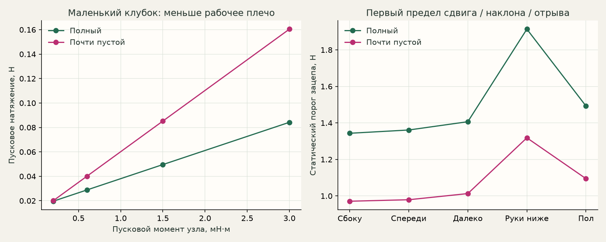

# Результаты расчёта PITAYA

Все числа ниже рассчитаны при сценарных, ещё не измеренных свойствах пряжи и подставки. Размеры ножек и площадки взяты из CAD. Это ориентиры для пробы, не аттестация изделия.

## Сбоку на столе

До рабочей руки 40 см по горизонтали, рука на 20 см выше поверхности под ножками. Подставка 230 г; полный клубок 100 г, почти пустой 10 г.

| Клубок | Подача | Пуск, Н | Пик связанной модели, Н | Порог зацепа, Н | Сцепление весь прогон |
|---|---|---:|---:|---:|---|
| Полный | Спицы | 0.029 | 0.092 | 1.34 | да, при допущениях |
| Полный | Крючок | 0.029 | 0.203 | 1.34 | да, при допущениях |
| Почти пустой | Спицы | 0.040 | 0.128 | 0.97 | нет; пик условный |
| Почти пустой | Крючок | 0.040 | 0.270 | 0.97 | нет; пик условный |

У почти пустого клубка в исходном сценарии не хватает сцепления с площадкой. Поэтому его динамические пики нельзя выдавать за реальные силы. Плотность посадки на палочку особенно важна; отдельный анализ `spindle_grip` показывает влияние дополнительного удерживающего момента.

## Что следует из сравнения

- Малый радиус клубка повышает пусковое натяжение при том же сопротивлении узла. Потеря массы не гарантирует лёгкой подачи.
- Резкие импульсы выбранного сценария крючка дают больший разгон и выбег. Это эффект заданного ритма, не обязательное свойство вязания крючком.
- При стандартных параметрах расчёт не выявил сдвига или наклона PITAYA в обычной подаче. Порог около одного ньютона относится к зацепу и не является большим запасом против сильного рывка рукой.
- При руках ниже высокой подставки низкий выход нити из остатка клубка может пересекать край. Изменение формы листьев не устраняет эту причину: важнее взаимная высота руки и подставки.
- При крутой тяге вверх уменьшается рабочее плечо и прижим клубка. Возможен другой режим схода нити, который модель не описывает.
- Более широкая опора улучшает предел наклона, но не исправляет скользкие ножки. Для сравнения меняйте реальную геометрию контакта, а не диаметр декора.

## Состав проверок

- 80 сценариев подставка × клубок × ритм × положение.
- 69 случаев чувствительности: сопротивление узла, трение ножек, упругость нити, сход слоёв и посадка на палочку.
- 864 геометрических проверки пути: два вида листьев, два клубка, три положения, три высоты выхода и 24 азимута. Это сетка проверок, не статистика вероятности.
- Аналитические тесты равновесия, касательной, инвариантности при повороте, интеграла подачи, ошибок конфигурации и сходимости по времени.

Для практической пробы сначала проверить низкое сопротивление вращению и посадку остатка клубка. Обычный столик рядом с рукой — разумная исходная конфигурация для испытания. После печати подставить несколько измерений по [инструкции](calibration.md).
