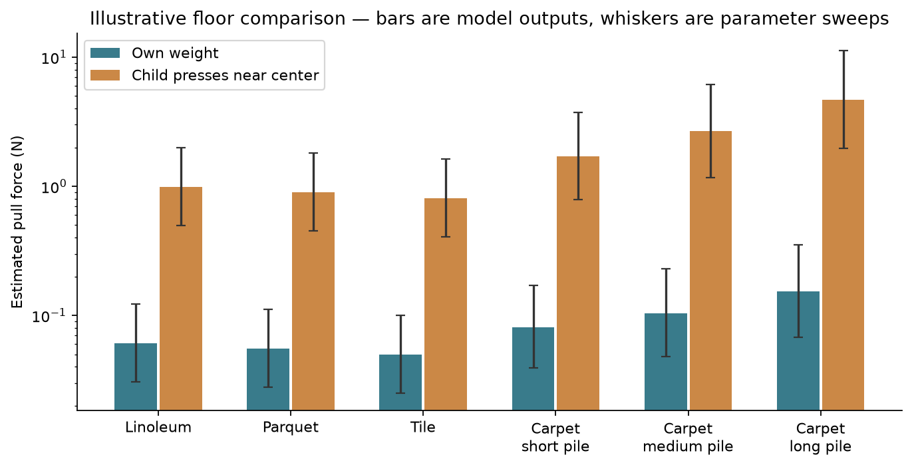

# Toy vehicle physics

A runnable mathematical model for printed toy vehicles with **N wheels**, plus
independent buoyancy, parent-contact and cleaning comparisons. This calculator
lives under `vehicles/toy-physics/` in [Mathematical models](../../README.md).
Run commands from this folder. Printable kits remain in
[3d-Models](https://github.com/Griboedow/3d-Models/tree/main/vehicles).

Open [the example report](reports/report.html) locally, or inspect
[the numerical results](reports/results.json) on GitHub. The report includes
linoleum, parquet, tile and short-, medium- and long-pile carpet examples.



## Run

Python 3.11 or newer, with the dependencies in `requirements.txt`:

```sh
python -m pip install -r requirements.txt
python -m unittest discover -s tests -v
python run.py
python run.py --material PETG --output reports/petg
```

All computation uses SI: meters, kilograms, newtons, pascals, joules and radians.
JSON keys contain units. Report figures convert selected outputs to mm, g or MPa.
No paid services, API keys or network access are needed to run the model.

**PLA is the default** (1.24 g/cm³); the PETG reference profile uses 1.28 g/cm³.
Use `--density-g-cm3` for your spool's value. Material selection updates
volume-based mass, contact elasticity, axle bending estimates and buoyancy.
The report compares both profiles and shows local axle stress utilization under
the child-load scenarios. See [MATERIALS.md](MATERIALS.md) for manufacturer
sources, print direction, editable strength factors and override rules.

To change the toy or a scenario, edit the JSON files in [examples](examples/):

| Input | Purpose |
|---|---|
| `material.json` | PLA/PETG, print axis, strength/modulus reductions, safety and stress concentration factors; optional density/property overrides |
| `vehicle.json` | Per-part polymer volumes/CG or fixed mass, plus arbitrary wheel list; geometry, contact properties, support stiffness, bearing friction and axle beam sections |
| `six_wheels.json` | Demonstrates more than three wheels and one wheel over a depression |
| `surfaces.json` | Floor properties; carpet pile, foundation stiffness, backing and losses |
| `loads.json` | Downward force or child mass × weight fraction, contact position and optional horizontal push |
| `buoyancy.json` | Separate floating bodies, shell thickness/infill, polymer density, flooding and optional ballast |
| `events.json` | Kick and step mechanics: speed, effective mass, stopping distance and contact area |
| `cleaning.json` | Brush/dirt size, gaps, pockets, drainage, layers and disassembly effort |

```sh
python run.py --inputs examples --output reports
python make_examples.py /path/to/3d-Models/vehicles/dune-trike/TRIKE_MINI_v06
```

The second command regenerates **all example inputs**, including the trike's
mass/CG estimate from current meshes and plate object masses. Save customized
inputs elsewhere first. It does not edit the 3D model. `run.py` stores hashes of
every input JSON so the report can be traced to its inputs.

## What is physical and what is assumed

- **Force and moment balance:** nonnegative wheel reactions, tipping, elastic
  load sharing for N > 3, wheel lift-off on uneven ground.
- **Contact:** cylinder-on-plane Hertz pressure for hard surfaces; a simplified
  compressible foundation for carpet. Printed tread is represented by a contact
  fraction, not resolved lug by lug.
- **Motion:** rolling-loss moment, journal friction, carpet deformation losses
  and an independent rigid-step climbing estimate.
- **Child pressing:** specified load and its position alter wheel reactions,
  pressures, axle stress utilization under assumed allowables, and tipping.
  This is a local beam screen, not a crush test or whole-toy strength check.
- **Floating:** actual clipped mesh volume and center of buoyancy, shell/infill
  mass, flooded voids, heave, roll, pitch and local restoring stiffness. The
  floating examples are independent boxes, not a claim that the trike floats.
- **Parent contact:** force, energy and pressure comparisons for a kick or step.
  There is deliberately no numerical pain or injury probability.
- **Washability:** a clearly labeled, adjustable heuristic for access, drainage,
  layer roughness and disassembly effort. No automatic mesh-based hygiene claim.

Floor presets and print reduction factors are **illustrative, uncalibrated inputs**.
Material reference data come from the linked Bambu product sheets, with explicit
specimen conditions; they are not measurements of this particular print.
The half/double parameter sweeps are not confidence intervals. The model does
not certify printed strength, impact safety or suitability for children aged 3+.

See [MODEL.md](MODEL.md) for equations, geometry conventions, validity limits and
primary references, and [CALIBRATION.md](CALIBRATION.md) for measurements that
would make the estimates useful for this particular toy.
