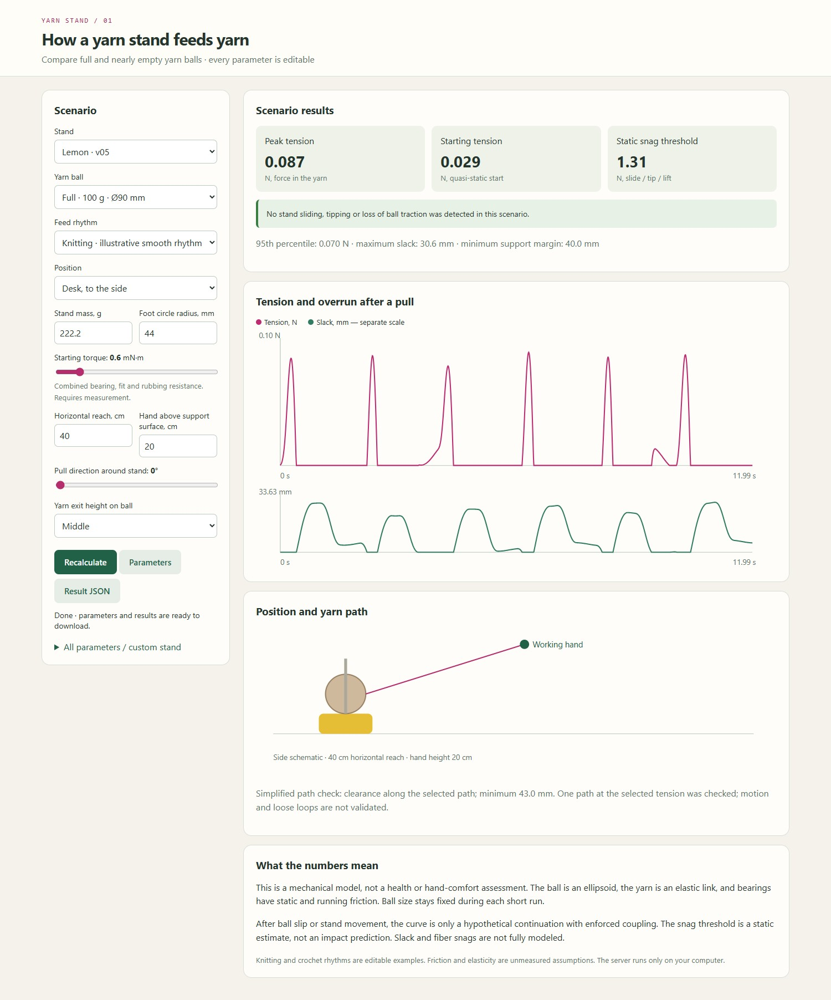
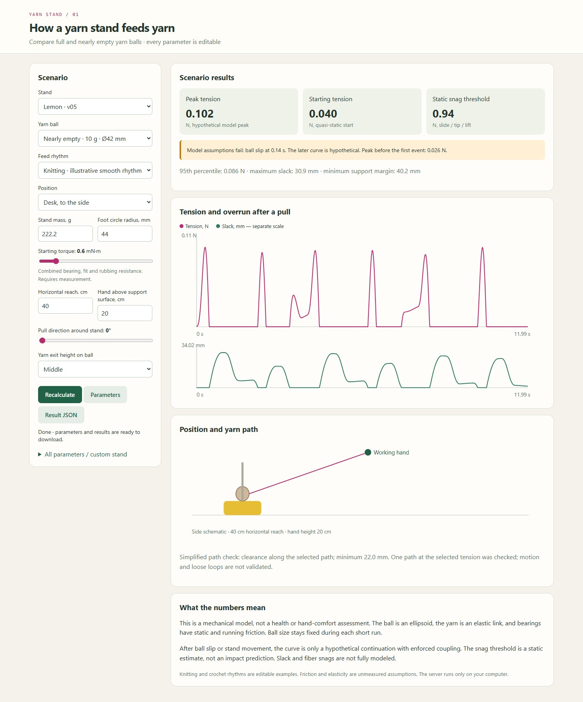

# Yarn Stand Simulator

Part of [Mathematical models](../../README.md), under `yarn/stand-simulator/`.
Run this calculator's commands from this folder. Package and CLI names remain
`yarn-stand-simulator` and `yarnstand` after the repository rename.

A small, reproducible mathematical model of a rotating yarn stand.
Compare full and nearly empty **round balls unwound from the outside**, knitting
and crochet rhythms, desk and floor placement, mass, feet, and rotational drag.

The example values are **engineering assumptions pending trial prints and measurements**.
This is not a hand-comfort rating or a model of individual fibers. The results
help identify what to change and test physically.

## Interface preview · English

The local browser UI includes editable scenarios, tension and slack plots,
a side schematic, model-validity warnings, and JSON import/export.
These are screenshots of the running app with the **Lemon v05** preset.

After `python -m yarnstand serve`, open
<http://127.0.0.1:8765/?stand=lemon_v05>.
The interface, documentation, and generated reports are in English.
Existing links with `lang=en` or `lang=ru` also open the English interface.

**Full ball, 100 g · illustrative knitting rhythm · desk-side position**



<details>
<summary>Compare: nearly empty ball, 10 g — model-validity warning</summary>

Select **Nearly empty · 10 g · Ø42 mm** in the Yarn ball menu.
The model flags loss of ball traction at **0.14 s**. The later curve and its
overall peak are hypothetical; the peak before the first event is **0.026 N**.



</details>

The screenshots use the saved [Lemon v05 input](examples/lemon_v05.json).
Mass and inertia are estimates; friction is unmeasured. The side view is a
simplified schematic, and its fast path check does not replace an exact STL audit.

## Running the simulator

Python 3.10 or later is required. The core calculation and interface use only
the standard library: no package installation or GPU is needed.
Run commands from this calculator's folder (`yarn/stand-simulator`), not the
repository root.

```sh
python -m yarnstand serve
```

Open <http://127.0.0.1:8765>. Adjust the ball, hand position, rhythm,
mass, foot circle radius, and friction. **All parameters / custom stand**
exposes the complete configuration, including a custom support polygon.
Data stays on your computer. Stop the server with Ctrl+C.

Open `/?stand=lemon_v05` to start with Lemon.

```sh
# Create editable parameters
python -m yarnstand preset --ball nearly_empty --motion crochet --setup high_table --out examples/my_stand.json
# Edit the JSON values, then run the calculation
python -m yarnstand run examples/my_stand.json --out results/custom.json
# Reproduce comparison tables and sensitivity analysis
python -m yarnstand suite
python -m yarnstand sensitivity
# Check physical limiting cases and numerical convergence
python -m pip install ".[mesh]"  # Full test suite, including STL checks
python -m unittest discover -s tests -v
# UI state checks (development only; Node 18+)
node --test tests/test_ui.js
```

Installing the package is optional: `python -m pip install .` adds the
`yarnstand` command. Report figures additionally require matplotlib:
`python -m pip install matplotlib`, then `python tools/make_report.py`.

## What it calculates

- Starting, mean, 95th-percentile, and peak yarn tension.
- Acceleration, stopping, and hypothetical excess yarn feed during overrun.
- Onset of stand sliding, tipping, or lift-off.
- Whether traction is sufficient for the ball and platform to rotate together.
- A rough taut-yarn path check near the rim and decoration.
- STL snag-risk checks: prescribed loops, rotating parts, print and fuzz
  allowances, CAD coordinates, and revision comparisons (`snag-audit`, `snag-compare`).
- Sensitivity to bearing friction, foot friction, and unwinding resistance.

The knitting and crochet rhythms are **two editable feed examples**, not results
from a study of knitters. Change the draw length, period, active fraction,
and hand-motion amplitude as needed. Hand height is measured **relative to the
surface under the feet**, not the platform top. Negative heights are allowed.

## Stand examples

`lemon_v05` is the final leafless lemon: a Ø96 mm platform at a height of 45 mm,
with six Ø10 mm feet on a 44 mm radius. Its mass of 222.189 g, rotor inertia of
0.0000332773 kg·m², and center-of-mass height of 30.011 mm are saved estimates
from the LEMON v05 calculation, **not measurements**. Friction retains the
original assumed values. A conservative axisymmetric envelope is used only
for the fast path check; it does not reproduce the asymmetric lemon body.
Reproduce the parameters from [`examples/lemon_v05.json`](examples/lemon_v05.json).

`peach_v13` has a platform 70.7 mm above the table and six Ø7.9 mm feet
on a 54 mm radius. Its mass of about 300 g and inertia of 0.0000545 kg·m²
come from CAD, diagnostic slicing, and hardware assumptions, **not measurements**.
Choose it in the interface or open `/?stand=peach_v13`.
Peach leaves are not approximated by ellipsoids in the fast schematic: check
their actual STL files separately with [mesh-check and mesh-sweep](docs/mesh.md).

`pitaya_v08` uses PITAYA v08 geometry: a Ø104 mm platform, six Ø10 mm feet
on a 52 mm radius, and a platform top about 45 mm above the table.
Its mass of 230 g and rotor inertia of 0.000065 kg·m² are estimates,
**not weighed values**. The feet determine the support area, not the pink body's
outer diameter.

`pitaya_v09` has wide stylized leaves (about 34 mm). Mechanism parameters and
mass estimates are unchanged; the leaves use wider approximate ellipsoids.
These are not exact CAD surfaces. Example:

```sh
python -m yarnstand preset --stand pitaya_v09 --out examples/pitaya_v09.json
python -m yarnstand run examples/pitaya_v09.json --out results/pitaya_v09.json
```

A check of selected zero-thickness paths against the v09 STL is saved in
[`results/pitaya_v09_mesh_paths.json`](results/pitaya_v09_mesh_paths.json).
It does not model ball deformation or loose loops. The original
`scenarios.csv` and `sensitivity.csv` still refer to the v08 specified in them.
With the unpacked v09 CAD package, reproduce this check separately:
`python -m pip install vtk`, then
`python tools/check_pitaya_mesh_paths.py /path/to/PITAYA_v09`.
This optional script expects the PITAYA assembly coordinate system;
the core simulator still runs without VTK or CAD files.

`wide_feet` is a hypothetical alternative stand with feet on a 62 mm radius;
it is not a finished PITAYA body modification. `light_small` represents a light,
compact design. `high_drag` represents a stiffer rotating assembly.

Full ball: 100 g, semi-axes 45×45×44 mm. Nearly empty: 10 g, 21×21×23 mm.
The fixed size in each 12-second run is a snapshot, not a simulation of an
entire evening's yarn consumption. A 200 g ball is also available in the
interface, with an explicit warning when it overhangs the platform.

## Interpreting results

Check `path_screen` and `nominal_path_valid` first. Body contact, an exit point
inside the ball, or a yarn path entering the ball make the force calculation
conditional even when support and traction hold. The interface displays this warning.
`hypotheses_valid_for_entire_run` combines these checks; it does not certify
all moving or loose loops. New presets use `unwind_radius_ratio=1`;
an imported legacy value of 0.85 is preserved but does not establish outside unwinding.

Check `first_events_s` next. After slip or loss of support, the curve is a
**hypothetical continuation with enforced coupling**. It does not predict
the motion of a ball that has already slipped. Do not compare these peaks
as exact forces during real knitting.

`valid_coupled_interval_end_s` and `peak_tension_before_first_event_N`
identify the interval before the first violation of these conditions.
Every JSON trace point includes `coupled_assumptions_valid`; later peaks
must not be presented as a calculation of a slipping ball.

`critical_snag_N` is the quasi-static external-force threshold at which a
support condition first fails. It is not an impact calculation.
`max_slack_m` is excess feed with ideal unwinding during overrun; real loops
may sag, wrap around the ball, or snag. Large slack triggers a separate warning.

**The model does not cover** center-pull unwinding, falling stands, soft sofas,
ball deformation or collapse, detailed winding structure, FDM micro-snags,
changes in human posture, or tension applied by fingers after the stand.
Steep pull angles receive a separate warning: yarn may come off over the top
of the ball instead of driving rotation in the assumed mode.

- [Equations, units, and limits](docs/model.md)
- [Peach v13 review](docs/peach-v13.md)
- [Peach v14: exit clearance and bearing fixes, compared with v13](docs/peach-v14.md)
- [Quick calibration after printing](docs/calibration.md)
- [PITAYA and comparison results](docs/results.md)
- [PITAYA v10 review archive and unchanged CAD fits](docs/pitaya-v10-recheck.md)
- [PITAYA v11: revised leaves, fits, and recalculation with 0.3.0](docs/pitaya-v11.md)
- [Audit fixes and the v10 recalculation archive with 0.2.0](docs/audit-fixes.md)
- [Snags: reviewing CAD before printing](docs/snags.md)
- [Raw scenarios](results/scenarios.csv)
- [Sensitivity](results/sensitivity.csv)

All input parameters are saved with the result. JSON exports represent undefined
or infinite values as `null`; events and statuses retain the reasons.
